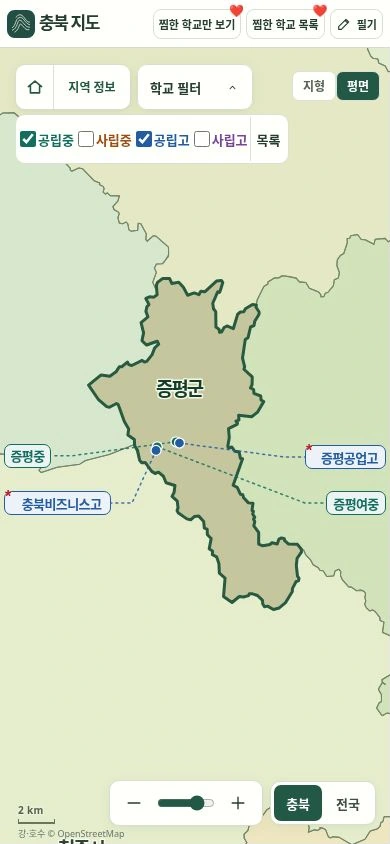
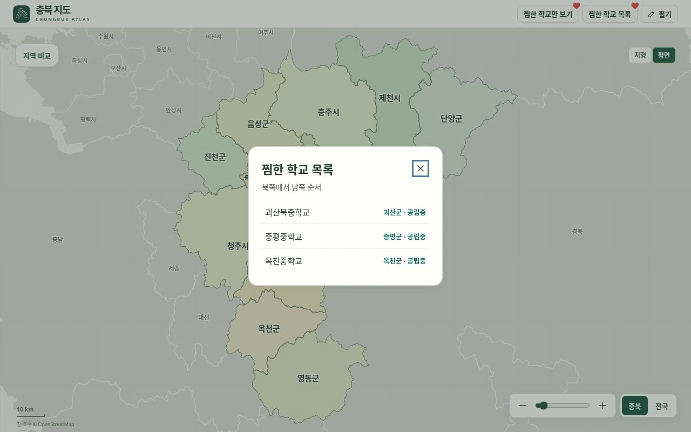
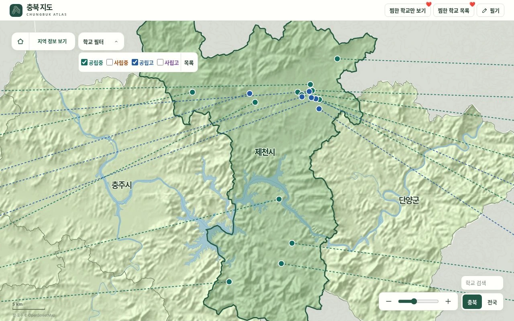
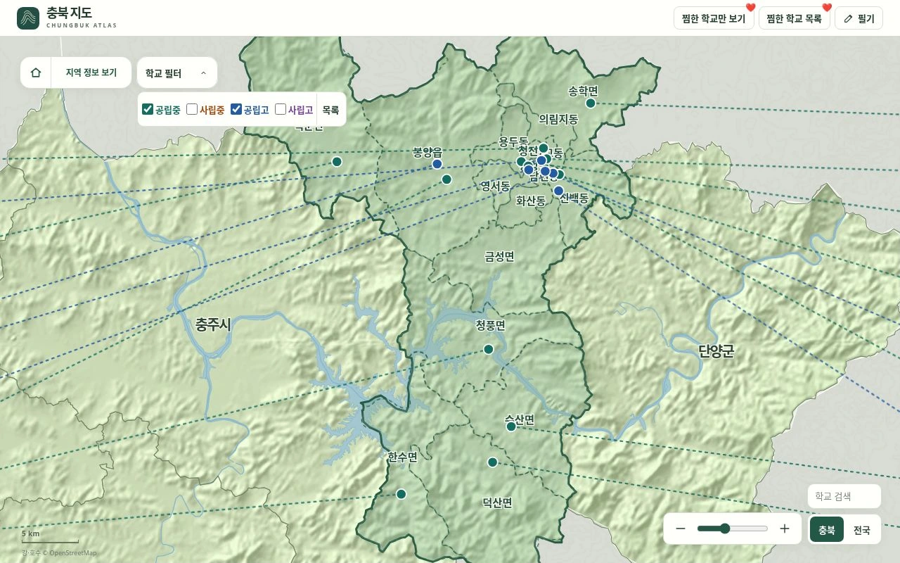

# 충북 지도 · 만든 과정 소개

[디자인 체크리스트](../CHECKLIST.md) · [지도 앱 열기](https://youe2019-commits.github.io/chungbuk-map/dist/)

사진 11장은 저장소에 남아 있는 버전의 앱을 브라우저에서 다시 열어 촬영했다. 컴퓨터 화면은 1280×800, 휴대폰 세로 화면은 390×844다. 각 비교 쌍은 화면 크기, 지역, 선택한 학교와 배율을 맞췄다. 왼쪽에 ‘고치기 전’, 오른쪽에 ‘고친 후’를 붙이면 된다.

## 2분 20초 구성안

| 시간 | 화면 | 내가 AI에게 한 요청 (대화 원문 발췌) | 바꾼 이유 (영상용 자막 초안) |
|---|---|---|---|
| 0:00–0:12 | 컴퓨터와 휴대폰에서 본 충북 지도 | | 충북의 학교를 찾아보고 찜할 수 있는 수업용 지도입니다. 직접 써 보면서 바꾼 네 장면을 소개합니다. |
| 0:12–0:42 | 같은 세 학교의 점과 카드. 전체 화면으로 비교한 뒤 옥천중의 점선을 따라간다. | “점선을 짧게 해서 좀 더 가깝게 보이도록 하자.” | 학교를 여러 곳 찜하니 카드가 양끝으로 흩어졌습니다. 카드와 지도 위 점을 가까이 두면 어느 학교인지 바로 연결해 볼 수 있습니다. |
| 0:42–1:12 | 증평중 카드를 확대한다. 왼쪽은 누르는 중, 오른쪽은 누르는 중에서 등록 완료로 전환한다. | “하트가 등록되는 것(과정)이 보이도록.” | 처음에는 누르고 있어도 화면이 그대로였습니다. 이제 하트가 커지면 터치가 인식된 걸 알고, 작아져 자리에 남으면 손을 떼도 됩니다. |
| 1:12–1:38 | 찜 목록의 같은 세 행을 나란히 확대한다. 위·아래 버튼과 삭제 버튼을 차례로 짚는다. | “그리고 찜한 학교 목록에서는 학교 순서 변경이나 삭제가 되면 좋겠어.” | 먼저 볼 학교는 위로 올리고, 다 본 학교는 그 자리에서 빼고 싶었습니다. |
| 1:38–2:08 | 같은 위치로 확대한 제천 지도. 시내에서 새로 표시된 동 이름을 확대한다. | “충주시와 제천시는 구로 구분해야하나 청주처럼?” | 제천에서는 읍·면·행정동으로 학교를 찾습니다. 시 전체에서는 작은 동 이름을 감추고, 시내를 확대할 때 읽을 수 있게 했습니다. |
| 2:08–2:20 | 휴대폰 지도에서 컴퓨터 전체 지도로 전환한다. | | 여러 학교를 함께 볼 때, 한 학교를 찜할 때, 동네를 찾아볼 때 화면이 어떻게 달라졌는지 살펴봤습니다. |

행정구역 장면은 사용자가 구분 방식을 먼저 질문하고 “계획대로 실행해줘.”라고 한 뒤 반영한 변경이다. 확대 시점과 라벨 표시 방식은 구현 내용을 설명하는 자막이다. 상단 여백은 가장 오래된 커밋(`024487d`)에도 이미 줄어 있어 이번 전후 비교에서 뺐다.

## 화면 원본과 촬영 조건

| 장면 | 고치기 전 | 고친 후 |
|---|---|---|
| 찜 카드 간격 |  |  |
| 누르는 동안의 하트 |  |  |
| 찜 목록 |  |  |
| 제천 행정동 |  |  |

- 카드·하트·목록은 `742af15` → `b30f906`을 비교했다. 카드와 목록에 사용한 학교는 괴산북중학교, 증평중학교, 옥천중학교다.
- 하트 장면은 등록 직전 앱의 애니메이션을 정지해 촬영했다. 이후 같은 카드에 작은 하트가 남은 [등록 완료 사진](public/screens/heart-saved.webp)으로 이어 붙인다.
- 제천은 `13732df` → `da63ce9`을 비교했다. 양쪽 모두 제천시를 선택한 다음 확대 버튼을 한 번 눌렀다.
- 도입과 마무리는 `484db83`의 [컴퓨터 전체 지도](public/screens/map-desktop.webp)와 [휴대폰 전체 지도](public/screens/map-mobile.webp)를 쓴다.
- 나중에 Remotion 프로젝트를 이 폴더에 만들면 `staticFile('screens/cards-before.webp')`처럼 사진을 불러올 수 있다.
