# 충북 지도 · 만든 과정 소개

[디자인 체크리스트](../CHECKLIST.md) · [지도 앱 열기](https://youe2019-commits.github.io/chungbuk-map/dist/)

## 이야기 줄기

충북 지도는 세 단계로 쓰는 앱이다. 영상도 이 순서를 따라, 단계마다 직접 써 보며 고친 장면을 고치기 전/후로 보여 준다.

1. **인구가 많은 곳 보기**: 인구밀도 지도로 어느 지역에 사람이 많이 사는지 안다.
2. **학교가 어디에 있는지 보기**: 지역을 골라 인구밀도 위에 학교 위치를 보고, 읍·면·동으로 나눠 찾는다.
3. **관심 있는 학교 고르기**: 학교를 찜하고, 찜한 학교를 모아 보고, 목록을 정리한다.

## 2분 58초 시나리오 (1920×1080, 30fps, 5340프레임)

장면 순서와 길이는 `src/ChungbukIntro.jsx`의 `ORDER`에 있다.

화면 위쪽에는 단계 이름과 장면 번호(예: `1단계 인구 보기 · 1/7`)를 띄운다. 비교 장면은 왼쪽 ‘고치기 전’, 오른쪽 ‘고친 후’이고, 양쪽에 같은 확대·이동을 적용한다. 아래에는 ‘내가 AI에게 한 요청’(대화 원문)과 ‘바꾼 이유’ 자막을 따로 띄운다.

| 시간 | 단계 · 장면 | 화면 | 내가 AI에게 한 요청 (대화 원문) | 바꾼 이유 (자막) |
|---|---|---|---|---|
| 0:00–0:12 | 도입 | 질문 “우리 지역에는 어떤 학교가 있고, 어디에 있을까요?” → 컴퓨터·휴대폰의 인구밀도 지도. 세 단계(인구 → 학교 분포 → 관심 학교)를 차례로 띄운다. | | 충북 학생·학부모·교직원이 우리 지역의 학교를 쉽게 찾아보도록 만든 수업용 지도입니다. 인구를 보고, 학교 분포를 보고, 관심 있는 학교를 고릅니다. |
| 0:12–0:36 | 1단계 인구 보기 ① 인구밀도 지도 | 전체 지도. 지형 → 시·군 인구밀도로 비교한 뒤, 두 번째 요청에 맞춰 시·군 → 읍·면·동 인구밀도로 넘어간다. 마지막에 청주 시내를 확대한다. | ① “지금 지도가 지형 지도인데, 인구밀도 지도로 나타내자. 디폴트를 인구밀도 지도로.” ② “눈이 불편하지 않은 색으로 하면 좋겠어. 그리고 조금 더 자세한 인구밀도 지도였으면 좋겠어. 시군 별로만 나누지 말고.” | 앱을 열자마자 어느 지역에 사람이 많이 사는지 보이도록 했습니다. 시·군 안에서도 시내와 산간 마을의 차이가 보이게 읍·면·동으로 나누고, 눈이 편한 색으로 바꿨습니다. |
| 0:36–0:58 | 2단계 학교 분포 ② 지역을 골랐을 때 | 괴산군을 누른 장면. 자리를 잡은 화면(전: 덮개로 흐려짐 / 후: 색 그대로)을 보여 준 뒤, 읍·면 조각이 떠오르는 순간(전: 회색 조각 / 후: 색과 함께)으로 넘어간다. | ① “지역 선택이 되어도 인구밀도 지도가 유지되도록 해줘.” ② “색까지 함께 떠오르게” | 지역을 고르면 덮개 때문에 인구밀도 색이 가려졌습니다. 이제 인구가 많은 곳과 학교 위치를 함께 보고, 읍·면 조각이 색과 함께 떠올라 어떻게 나뉘는지 보입니다. |
| 0:58–1:14 | 2단계 학교 분포 ③ 단양 읍·면 | 단양군을 누른 장면. 전: 군 전체 / 후: 8개 읍·면과 이름. 단성면을 짚는다. | “단양군 읍, 면 구분 추가해줘.” | 다른 군처럼 단양도 읍·면을 눌러 그곳 학교만 볼 수 있게 했습니다. |
| 1:14–1:36 | 2단계 학교 분포 ④ 제천 행정동 이름 | 같은 위치로 확대한 제천 지도. 시내에서 새로 표시된 동 이름을 확대한다. | “충주시와 제천시는 구로 구분해야하나 청주처럼?” | 제천에서는 읍·면·행정동으로 학교를 찾습니다. 시 전체에서는 작은 동 이름을 감추고, 시내를 확대할 때 읽을 수 있게 했습니다. |
| 1:36–2:02 | 3단계 관심 학교 ⑤ 찜하기 하트 | 휴대폰 화면의 증평중 카드를 확대한다. 왼쪽은 누르는 중, 오른쪽은 누르는 중 → 등록 완료. | “하트가 등록되는 것(과정)이 보이도록.” | 처음에는 누르고 있어도 화면이 그대로였습니다. 이제 하트가 커지면 터치가 인식된 걸 알고, 작아져 자리에 남으면 손을 떼도 됩니다. |
| 2:02–2:26 | 3단계 관심 학교 ⑥ 찜한 학교만 보기 | 같은 세 학교의 점과 카드. 전체 화면으로 비교한 뒤 옥천중의 점선을 따라간다. | “점선을 짧게 해서 좀 더 가깝게 보이도록 하자.” | 학교를 여러 곳 찜하니 카드가 양끝으로 흩어졌습니다. 카드와 지도 위 점을 가까이 두면 어느 학교인지 바로 연결해 볼 수 있습니다. |
| 2:26–2:46 | 3단계 관심 학교 ⑦ 찜 목록 정리 | 찜 목록의 같은 세 행을 나란히 확대한다. 위·아래 버튼과 삭제 버튼을 차례로 짚는다. | “그리고 찜한 학교 목록에서는 학교 순서 변경이나 삭제가 되면 좋겠어.” | 먼저 볼 학교는 위로 올리고, 다 본 학교는 그 자리에서 빼고 싶었습니다. |
| 2:46–2:58 | 마무리 | 휴대폰 인구밀도 지도에서 컴퓨터 전체 지도로 전환한다. 세 단계를 다시 띄우고 앱 이름과 주소로 끝낸다. | | 인구를 보고, 학교가 어디에 있는지 살피고, 관심 있는 학교를 고르는 지도. 직접 써 보며 일곱 장면을 고쳤습니다. |

- ①의 두 요청은 화면 전환에 맞춰 차례로 띄운다(지형→시·군일 때 첫 요청, 시·군→읍·면·동일 때 두 번째 요청).
- ②도 같은 방식이다. 자리 잡은 화면일 때 첫 요청, 떠오르는 순간일 때 두 번째 요청을 띄운다.
- ④ 행정구역 장면은 사용자가 구분 방식을 먼저 질문하고 “계획대로 실행해줘.”라고 한 뒤 반영한 변경이다. 확대 시점과 라벨 표시 방식은 구현 내용을 설명하는 자막이다.
- 청주시 첫 화면(기관 카드), 상단 여백, 속도 개선은 이야기 줄기와 거리가 있어 [체크리스트](../CHECKLIST.md)에만 남겼다.

## 화면 원본과 촬영 조건

컴퓨터 화면은 1280×800, 휴대폰 세로 화면은 390×844다. 각 비교 쌍은 저장소에 남아 있는 해당 버전의 앱을 브라우저에서 다시 열어 촬영했고, 화면 크기·지역·선택한 학교·배율을 맞췄다.

| 장면 | 고치기 전 | 고친 후 |
|---|---|---|
| ① 인구밀도 지도 (1차) | 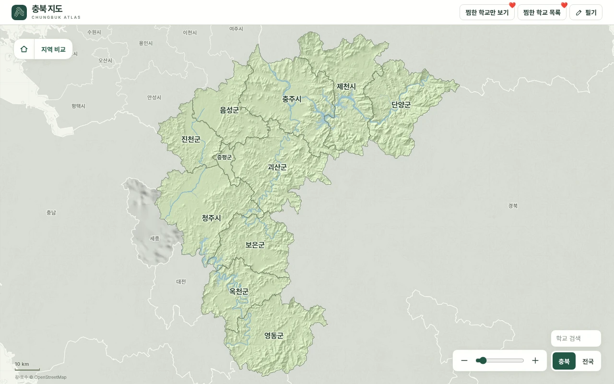 | 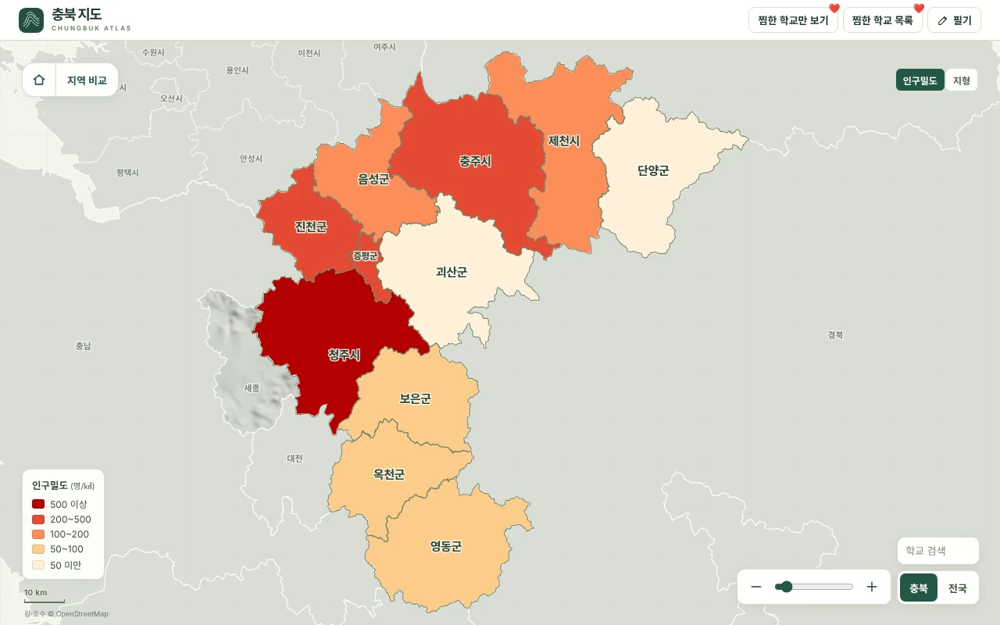 |
| ① 인구밀도 지도 (2차) |  | 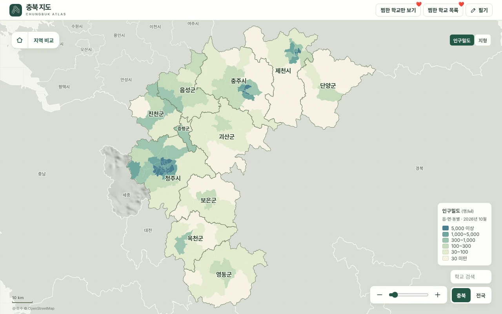 |
| ② 지역 고를 때 (떠오르는 순간) | 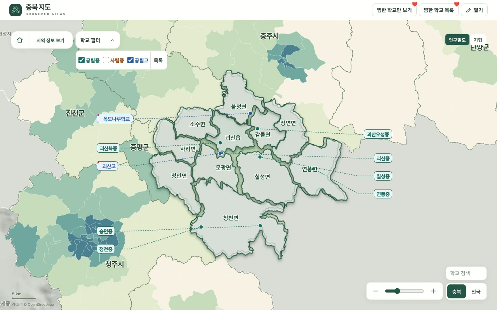 | 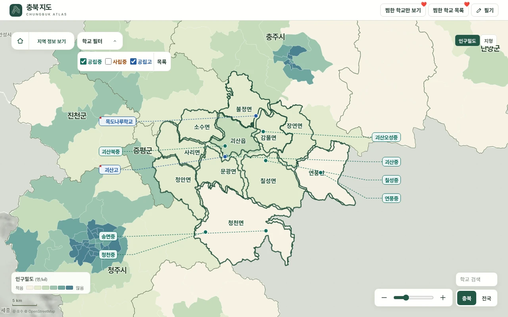 |
| ② 지역 고를 때 (자리 잡은 뒤) | 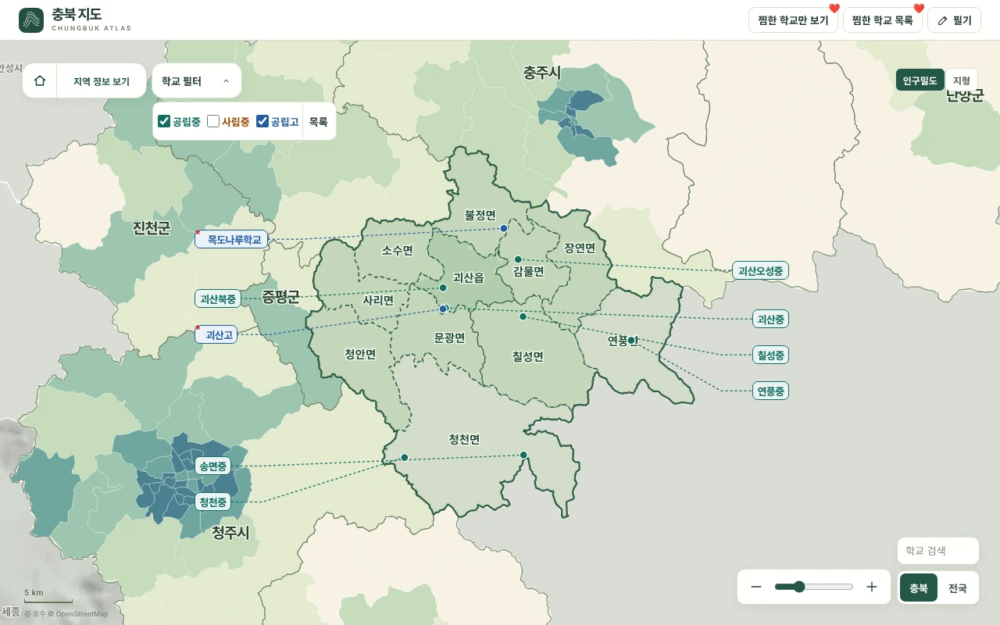 | 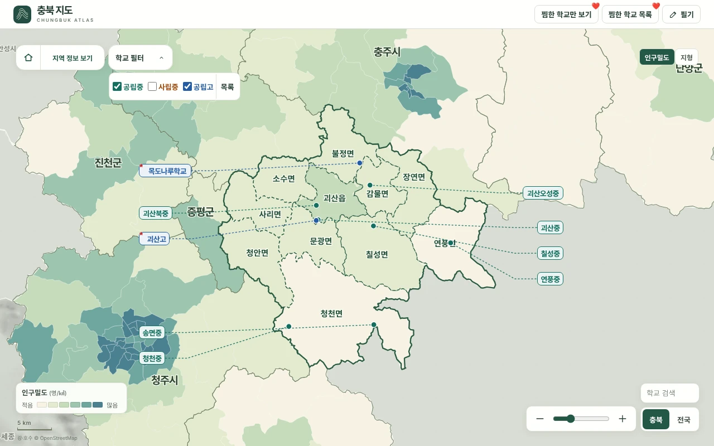 |
| ③ 단양 읍·면 | 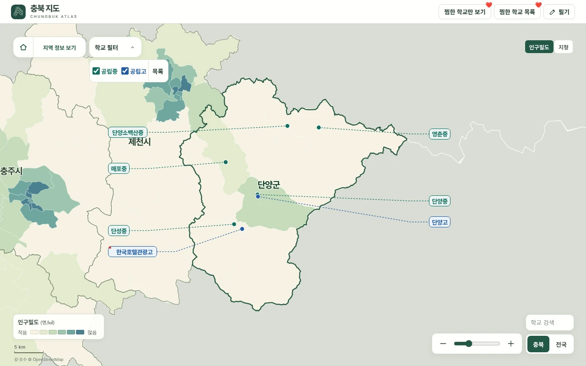 | 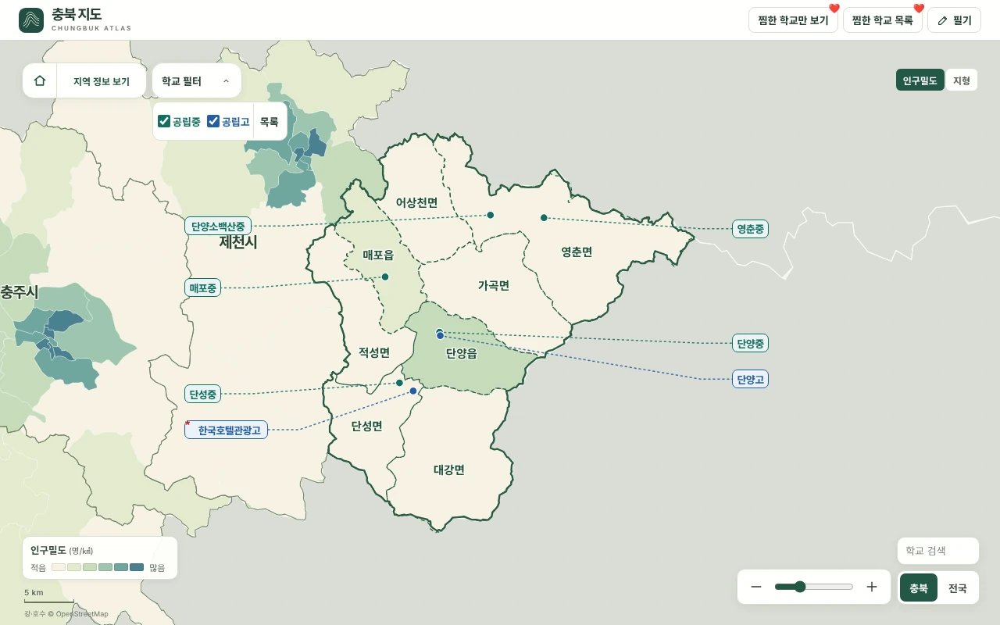 |
| ④ 제천 행정동 |  |  |
| ⑤ 누르는 동안의 하트 |  | 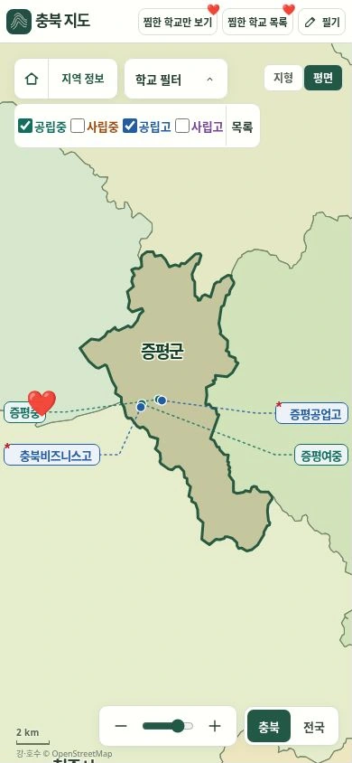 |
| ⑥ 찜 카드 간격 | 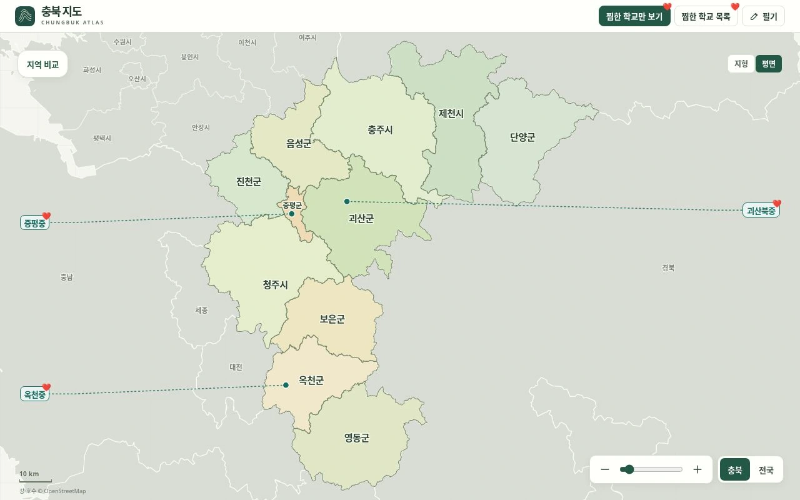 |  |
| ⑦ 찜 목록 |  | 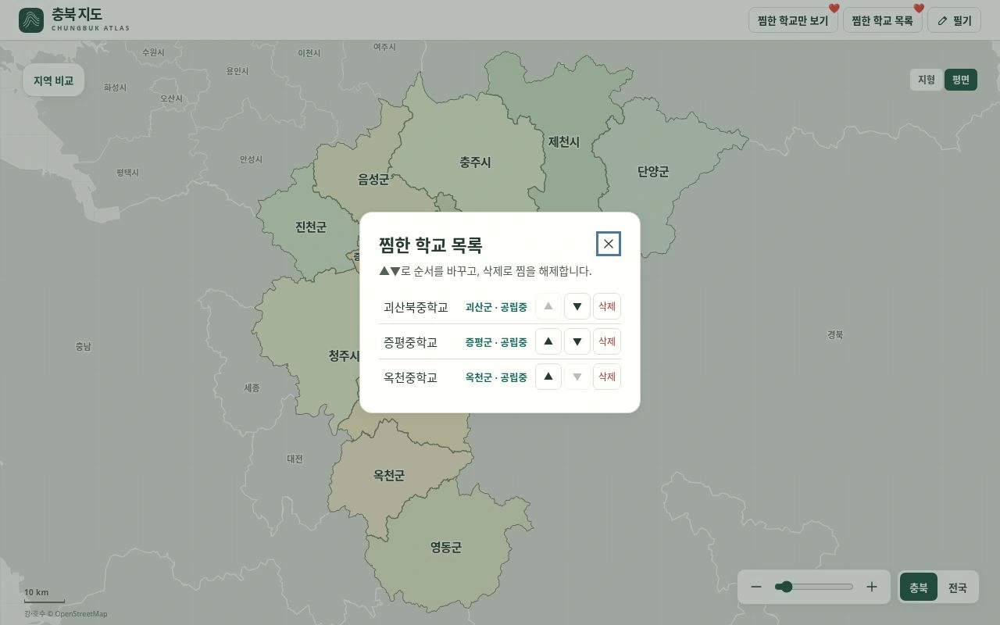 |

- ① 인구밀도: `3eba0d6`(지형) → `d7a87df`(시·군) → `f04d28a`(읍·면·동). 모두 처음 화면 그대로다.
- ② 지역 선택: `7d7538d` → `f04d28a`. 양쪽 모두 괴산군을 눌렀다. ‘떠오르는 순간’은 효과 시작 1.1초 지점에서 멈춰 촬영했다.
- ③ 단양: `e8308e1` → `f04d28a`. 양쪽 모두 단양군을 눌렀고, 필터는 기본(공립중·공립고)이다.
- ④ 제천: `13732df` → `da63ce9`. 양쪽 모두 제천시를 선택한 다음 확대 버튼을 한 번 눌렀다.
- ⑤~⑦ 카드·하트·목록: `742af15` → `b30f906`. 카드와 목록에 사용한 학교는 괴산북중학교, 증평중학교, 옥천중학교다. 하트 장면은 등록 직전 애니메이션을 정지해 촬영했고, 같은 카드에 작은 하트가 남은 [등록 완료 사진](public/screens/heart-saved.webp)으로 이어 붙인다.
- 도입과 마무리는 `f04d28a`의 [컴퓨터 인구밀도 지도](public/screens/map-desktop-density.webp)와 [휴대폰 인구밀도 지도](public/screens/map-mobile-density.webp)를 쓴다. 예전 지형 지도 사진(`map-desktop.webp`, `map-mobile.webp`)은 지금 쓰지 않는다.
- ④~⑦은 인구밀도 지도를 만들기 전 버전이라 지형·평면 지도 위에서 촬영되었다. 비교하는 변경 사항은 지금 앱에도 그대로 있다.
- Remotion에서는 `staticFile('screens/density-dong.webp')`처럼 사진을 불러온다.
